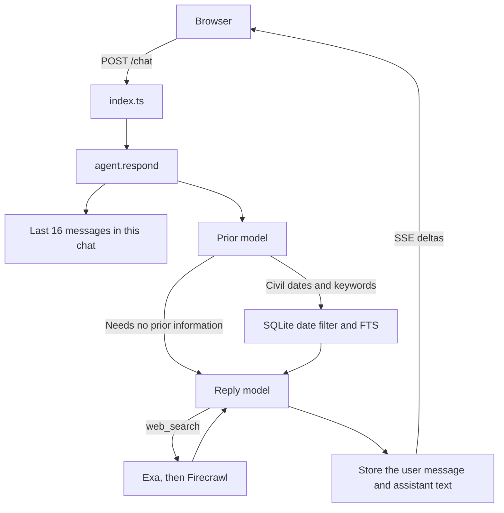

# Design

`npm install` then `npm run dev` starts one Node process. `scripts/dev.mjs` loads `.env` and adds the experimental flags this Node version still needs for `node:sqlite` and TypeScript. The process creates `data/chat.sqlite`, serves one HTML page, and prints the local URL. If the preferred port is taken, it tries the next ten.

Copy `.env.example` to `.env` and set `OPENROUTER_API_KEY`, `EXA_API_KEY`, and `FIRECRAWL_API_KEY`. `OPENROUTER_MODEL` defaults to `anthropic/claude-sonnet-4.6`. `OPENROUTER_PRIOR_MODEL` defaults to `google/gemini-2.5-flash`. `TIMEZONE` defaults to `Asia/Kolkata`, and every calendar boundary is interpreted there.

## Architecture

Two models, one database, one tool. The page never talks to a model. It talks to `src/index.ts`, which runs a turn in `src/agent.ts` and streams the reply back.

| Piece | Role |
| --- | --- |
| `public/index.html` | The only page. Lists chats, loads a transcript, posts a message, paints streamed text. |
| `src/index.ts` | `node:http`. Serves the page, chat list, and transcript. `POST /chat` is a server-sent event stream. |
| `src/agent.ts` | One turn: recent window, prior decision, reply, sources, then the save. |
| `src/prior.ts` | Smaller model. Decides whether older turns are needed, and names a range and keywords. This call is not a tool. |
| `src/dates-model.ts` | Writes the calendar the prior model copies from: nearby days and month starts. |
| `src/dates.ts` | Turns a civil date into that timezone's midnight. |
| `src/tools/recall.ts` | Turns the prior decision into a bounded read. The reply model does not call this. |
| `src/db.ts` | `node:sqlite`. Chats, messages, and an FTS5 index on message text. |
| `src/tools/search.ts` | The only tool, `web_search`. Exa for hits, Firecrawl to read a page, Exa again if the page is a wall. |

The browser uses four routes:

- `GET /` returns the HTML file read at startup.
- `GET /chats` returns chats, newest first.
- `GET /messages?chat=` returns that chat's messages in order.
- `POST /chat` accepts `{ message, chatId }` and streams `chat`, `status`, `delta`, `done`, and `error`. Closing the response aborts the turn.

A new `chatId` of null creates a chat titled from the first line of the message. A missing chat is a 404. A message over 32,000 bytes is rejected. If the turn fails before anything is stored, the empty chat is deleted.

SQLite is in-process, WAL, with a five-second busy timeout. `chats` holds the title and timestamps. `messages` holds `user` and `assistant` rows. `messages_fts` is a contentless FTS5 table kept in step by an insert trigger. An older database whose messages have no `chat_id` is folded into one chat on open. Hosted Postgres would add a connection string and a network hop for a log that is one conversation.

## A turn

The last 16 messages of this chat are the conversation. Before the reply, the prior model runs once. It answers `Needs no prior information`, or it returns `recall` with a calendar range, a few keywords, and an error string when the named time cannot exist. Code reads the matching rows. Those older turns are written into the instructions. Rows already inside the 16-message window are left out of that block. The reply model then sees the recent messages as the conversation and the older ones as text above it.

The reply model calls `web_search` when the answer depends on the live web, including when a stored claim has to be checked against the web now. If the messages already answer the question, it calls nothing. The loop stops after 8 steps.

The reply starts with one line, `Context: chat`, `earlier`, `both`, or `none`. That line is stripped before the reader sees it, and it decides which sources are appended. A Sources section is added only for pages the tool returned and for earlier messages the reply says it used. The user message and the assistant text are stored when the reply finishes. Tool payloads are not stored. The reply is what a later turn should find.

## Dates and recall

The lookup never receives SQL. The prior model returns `start` and `end` as civil dates, `YYYY-MM-DD`. `start` is inclusive and `end` is exclusive. A day ends on the next civil day. A week starts on Monday and ends on the next Monday. The prompt lists the nearby days and the month starts, split into months that have started and months that have not, and tells the model to copy those dates. A misspelled weekday is still that weekday. A missing year is the latest occurrence that is not in the future. "Last Tuesday" on a Tuesday is the week before. Anything unrecognized is an error string, not a guess.

`src/dates.ts` is the only place those dates become instants: midnight in `TIMEZONE`, then a half-open range on `created_at`. A keyword query is an FTS5 `OR` over words of two letters or more. The read returns at most 20 messages, oldest first, and can span chats. A query that names no time, no keywords, and no cursor skips the current chat, because those rows are already in the window.

## Web search

`web_search` takes a query or a URL. A URL is read as a page and returns no hit list. A query asks Exa for five results and their highlights. The result whose title, highlight, and URL share the most query words is preferred, and titles that look like roundups are penalized. If that highlight is already 500 characters, it is returned. If it is thinner, Firecrawl reads the page as markdown, capped at 8,000 characters. A wall, a captcha, or an empty body falls back to one fresh Exa read (`maxAgeHours: 0`). If both fail, the tool says the page could not be read.

## What this leaves out

The published sample questions are not special-cased. The prompt, the tools, and the date tests do not mention them. The date tests take a fixed clock and check the model against the ranges, including misspelled weekdays.

Memory is one `messages` table plus FTS5. There is no episode table and no vector index. An episode row would duplicate the transcript unless a second model call extracted entities. A vector index cannot resolve "last Tuesday", because that date is `created_at` and is not in the text, and on a single-user log it can return a near miss instead of the sentence that was actually said. The prior model supplies the keywords when the user paraphrases.

The page is one HTML file served by `node:http`. There is no React and no Next.js. The reply model has one tool, `web_search`. Earlier messages are read in code from what the prior model names, and the rows are already in the prompt when the reply starts.

## Another week

If keyword recall starts missing paraphrases in a long history, add a vector index as a second pass inside an already date-filtered set, and keep the verbatim row as the thing the model reads. A write-time extractor for names and claims would make "which ones did we pick" a list instead of a transcript. A browser read, used only after Firecrawl and Exa both return a wall, would cover the pages that are still empty.
